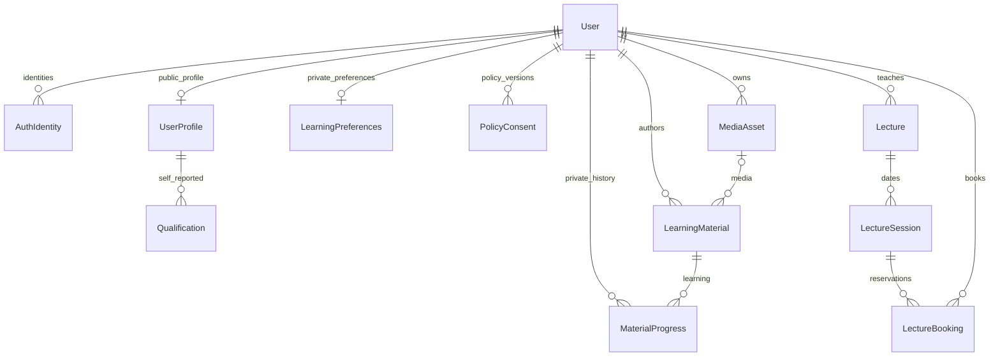

# PostgreSQL 基盤

永続化の基盤に加え、Webの登録・ログイン・ログアウトとマイページをDBに接続した。Unityはログイン本人の表示用プロフィールを参照する。Better Authによるメール・パスワード認証とプロフィール保存の手順は [認証の実装](./authentication.md) を参照。旧広場・教材・予約の操作APIは引き続き未接続。

## 構成

- 2026-10-27にSupabaseの新規プロジェクト `melife-dev` へ接続した。アプリはSupabaseのPostgreSQLを利用する。接続・起動手順は [Supabase接続](./supabase.md) を参照。
- Prisma 7.10.1 と `pg` ドライバー。Node.js 22.12 以上の 22.x、または 24 以上を使用する。
- `prisma/schema.prisma` がモデル定義、`prisma/migrations/` が適用順序を含む変更履歴。CHECK 制約・予約トリガーは第2マイグレーションに手書きで保持する。
- 全アプリテーブルは `app` スキーマに配置し、PUBLIC のスキーマ権限を取り消す。Supabase の公開 API 対象スキーマへ追加しない。サーバー側の接続を通して扱う。
- `server/db/client.ts` の `getDatabase()` は Next.js サーバー専用。初回アクセス時だけ接続を作り、開発時の再読み込みでも共有する。各 Node プロセスの接続プールは最大5、接続待ちは5秒。
- CLI とテストは `server/db/connection.ts` のファクトリーを使い、終了時に `$disconnect()` する。接続文字列・クエリー・個人データは自動ログ出力しない。

## データの関係



| 保存対象 | 設計上の区別 |
|---|---|
| User / AuthIdentity | 永続 userId と認証事業者の subject を分離。広場の participantId は保存しない。パスワード・認証トークンは保存しない |
| UserProfile | 表示名・任意の自己申告年齢・教えたいこと・学びたいこと。表示名の重複は許可。年齢入力を本人確認・保護者確認に流用しない |
| LearningPreferences | 非公開の興味・目標・得意なことと AI 年齢利用許可。プロフィール公開と AI 年齢利用を独立させる |
| Qualification / PolicyConsent | 自己申告の資格、同意した規約の識別子と版。資格は運営認定を意味しない |
| MediaAsset / LearningMaterial | ファイル本体はオブジェクトストレージ。DB には保存キー・種別・状態・サイズと教材情報を保持。署名付き URL は永続保存しない |
| MaterialProgress | 本人による受講完了と時刻・参照版・題名スナップショット。教材の論理削除後も履歴を残し、完了を自動判定しない |
| Lecture / LectureSession / LectureBooking | 講座内容・開催日時・予約を分離。予約不要の動画教材と混同しない。開催回の定員は受講者数で、広場の同時接続枠とは別 |

日時は `timestamptz` で保持し、表示時に日本時間などへ変換する。メールは空白を除いて小文字化した値だけを保存できる。ユーザーは既定で `PENDING`。開発版のログイン・マイページ利用と、予約等の `ACTIVE` を要する権限は分け、自動で `ACTIVE` にしない。保護者確認の採否は再検討中。

認証追加で `User` に認証用項目を追加し、`AuthAccount` / `AuthSession` / `AuthVerification` / `AuthRateLimit` を加えた全16テーブル構成になった。資格情報のハッシュとセッショントークンは専用テーブルでサーバー側だけが扱う。`User` / `AuthIdentity` に平文パスワードを保存しない。

## ローカルの初回起動

Supabaseのアプリ用接続文字列とCA証明書のパスを `.env.local` に設定する。詳細は [起動手順](./supabase.md#start) を参照。

```powershell
npm.cmd ci
# .env.local が存在しない場合だけコピーする。既存の接続設定は上書きしない。
if (-not (Test-Path .env.local)) { Copy-Item .env.example .env.local }
# .env.local の DATABASE_URL と証明書のパスを設定してから続行する。
npm.cmd run auth:setup
npm.cmd run db:check
npm.cmd run dev -- --hostname 127.0.0.1 --port 3002
```

日常の起動でマイグレーションは実行しない。作業を終えるときはWebのターミナルでCtrl+Cを押す。再開は `npm.cmd run dev -- --hostname 127.0.0.1 --port 3002`。

## スキーマ変更と検証

```powershell
npm.cmd run db:generate
npm.cmd run test:db
npm.cmd test
npx.cmd tsc --noEmit --incremental false
npm.cmd run build
```

スキーマ変更の生成は共有Supabaseとは別のローカル開発用PostgreSQLへ接続した状態で行う。`DATABASE_URL` と `DIRECT_URL` の両方をその専用DBに合わせてから `npm.cmd run db:migrate -- --name describe_change` を使う。新しい SQL の破壊的変更や手書きトリガーへの影響をレビューし、マイグレーションを Git へ登録する。既に適用した SQL は編集せず、後続マイグレーションで変更する。共有環境で `db:migrate` / `db push` / `migrate reset` は実行しない。

DB統合テストや認証ブラウザーテストを実行する担当者は、ローカルPostgreSQLに空の `melife_test` DBと専用ログインユーザーを別途用意し、その接続文字列を `.env.local` の `DATABASE_TEST_URL` に設定する。これはアプリの通常利用には不要。

`test:db` は明示的な `DATABASE_TEST_URL` を必須とし、localhost の末尾 `_test` の DB だけを許可する。開発用 URL と同じ接続先も拒否する。専用 DB にマイグレーションを適用し、作成した検証データだけを後片付けする。テスト用接続はマイグレーションを適用できる権限が必要。共有Supabaseへ向けるために接続先制限を外さない。

`db:seed` はローカルの `melife` / `melife_test` にだけ実行可能。`demo@example.invalid` のデモプロフィールを冪等に作成し、認証情報は作らない。通常のSupabase接続では実行しない。

実 DB テストでは、初回マイグレーション、制約、メール／認証IDの重複、プロフィール保存の原子性、メディアの所有者整合、教材削除後の履歴、同時予約、取消後の枠解放、締切、定員変更を検証する。

予約トリガーは開催回の行を更新して書き込みを直列化する。定員を超える予約、講師本人・未有効アカウントの新規予約、締切（開始30分前）以降の新規予約を拒否する。締切はロック取得後の DB 時計で判定する。スナップショット分離で競合したトランザクションは失敗させ、古い人数で確定しない。将来の API では競合を制限回数だけ再試行し、満員・締切・重複・権限エラーを利用者向けの応答へ変換する。

予約済み開催回の開始・終了・講座参照の変更、および予約数より少ない定員への変更を拒否する。日程変更の通知・予約の移行方式が未決のため、暗黙に変更しない。新しい開催回を作り直す方法も含め、API 実装時に設計する。

## 公開環境への切り替え

1. PostgreSQL の本番用 DB を用意し、開発・検証とは分離する。アプリと DB のリージョンを近づける。
2. マイグレーション用の所有者接続を `DIRECT_URL` に設定する。必要なスキーマ作成・テーブル・関数作成権限を持つ直接接続またはセッションモード接続を使う。
3. インストールとビルドは `npm ci` → `npm run build`。接続情報なしでも Prisma Client 生成・静的ページのビルドは可能。本番で実データに触れるときは `DATABASE_URL` が必要。
4. デプロイ工程で、同時実行を制御した1ジョブから `npm run db:deploy` を実行する。適用済みマイグレーションは再実行されない。プレビュー環境には本番と別の DB を使う。
5. アプリには専用の制限されたログインロールを作り、その接続を `DATABASE_URL` に設定する。スーパーユーザー・DB所有者・BYPASSRLS 権限は付けない。マイグレーションでスキーマを作った後、必要な権限を同じマイグレーション所有者から次で付与する。

```powershell
psql $env:DIRECT_URL -v ON_ERROR_STOP=1 -v runtime_role=melife_app -f prisma/grant-runtime-role.sql
```

6. `db:status` と `db:check` で適用状況と実行ロールの接続を確認し、その後アプリを切り替える。接続情報をコンソールへ表示しない。DB プロバイダー指定の TLS と証明書検証を使用する。証明書検証を無効化する設定は追加していない。実行時にプーラーを使う場合も、マイグレーションは別接続とする。プール上限5はプロセスごとなので、同時起動数を含めて DB 側の接続上限と調整する。
7. バックアップと復元試験を用意し、認証・所有権チェックを持つ API と接続してから公開する。Supabase の公開キーを Prisma の接続情報の代わりにしない。`app` スキーマはサーバー専用で、行単位の閲覧制御を行う公開 API は今回提供しない。

## バックアップ

本番はプロバイダーのバックアップを設定し、復元先を別途用意して復元を試す。手元でバックアップを取る担当者は、接続先と互換性のあるPostgreSQLクライアントツールを用意する。PowerShellのバイナリーリダイレクトは使わず、出力先を `pg_dump` に渡す。

以下は `DIRECT_URL` を環境変数として設定済みのシェルで実行する。PostgreSQLのクライアントツールは `.env.local` を自動では読み込まない。

```powershell
New-Item -ItemType Directory -Force backups
pg_dump --dbname $env:DIRECT_URL --schema app --format custom --file backups/melife.dump
pg_restore --list backups/melife.dump
```

`backups/` は Git 対象外。保管・暗号化・保持期間・復元目標は公開運用前に決める。DB バックアップは動画ファイル本体のバックアップを含まない。

## 依存関係の更新状況

DB 基盤追加時に確認した Next.js 14.2.35 の脆弱性は、Issue #4 対応で Next.js 16.4.2 へ更新した。React・開発設定の更新内容、回帰確認、開発用依存関係に残る監査指摘は [Next.js 更新記録](./next-upgrade.md) を参照。

## 今回確定しない範囲

- メール所有者確認・パスワード再設定・未成年の利用条件。保護者確認は採否を再検討中。現在のメール・パスワード認証とセッション管理は [authentication.md](./authentication.md) を参照。
- 年齢の自動更新・必須化、プロフィールの閲覧範囲、履歴の保持期限とアカウント削除手順。
- メディア検証・公開停止・署名付き URL 発行。DB は所有者と参照の整合を保つが、公開処理はメディアの READY 状態・種別・認証本人を API 側で検証する必要がある。
- 教師／会場の予定重複、講座会場と広場枠の調整、講座取消通知、出席と本人完了の業務条件。
- 高頻度のアバター位置・音声・映像の永続化。これらを毎フレーム DB に保存しない。
- Unity の編集、クラウド契約、デプロイ、実 AI への個人データ送信。
